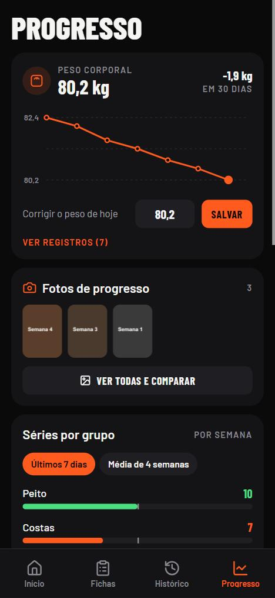

<p align="center"></p>

# Forja

App de treino de força para Android, **open source**, **sem conta e sem nuvem**: tudo fica no seu celular.
Feito em português, para quem treina na academia ou em casa e quer anotar séries, ver a carga subir e
não depender de assinatura.

<p align="center">
  
  
  
</p>

## O que ele faz

**No treino**
- Fichas A/B/C da academia e fichas de casa; a próxima ficha da sequência aparece pronta na tela inicial
- Cada série já vem com a carga e as repetições da última vez ("Última")
- **Sugestão de carga** (progressão dupla): bateu o topo da faixa de reps em todas as séries? Vem +2,5 kg
- Selo de **recorde**, **calculadora de anilhas** por lado e **anotação** por exercício (ex.: "banco 4")
- Cronômetro de descanso por exercício, com **aviso mesmo com a tela bloqueada**, e a tela fica acesa
- Trocar exercício (aparelho ocupado), mudar a ordem, treino livre e atividades avulsas (corrida, futebol…)
- Medidas por tipo: carga × reps, só reps (peso do corpo), tempo (prancha), cardio (tempo + km), alongamento
- 249 exercícios em 13 grupos, com foto ou boneco animado do movimento

**No progresso**
- Resumo ao finalizar: volume, recordes batidos e comparação com a última vez
- Gráfico de evolução por exercício (maior carga, 1RM estimado, volume)
- Séries por grupo muscular na semana, com a marca de 10 séries
- Peso corporal com gráfico, **fotos de progresso** por dia de treino e comparação antes/depois
- **Passos do dia** lidos do Health Connect (opcional)
- Meta semanal de treinos e sequência de semanas batendo a meta

**Seus dados**
- Histórico por dia, com edição de treino já salvo
- Backup em arquivo `.json` (pelo menu de compartilhar), em texto, e exportação em planilha CSV

## Privacidade

O Forja não tem servidor, login, anúncios nem rastreamento. Os dados ficam no armazenamento do app no
celular e só saem quando você mesmo faz um backup. As permissões são todas opcionais:

| Permissão | Para quê |
|---|---|
| Notificações | Avisar o fim do descanso com a tela bloqueada |
| Câmera | Tirar fotos de progresso |
| Passos (Health Connect) | Mostrar os passos do dia; o Forja só lê, nunca grava |

## Instalar

Baixe o APK na página de [Releases](../../releases) (quando houver) ou gere o seu, como abaixo.
No celular, abra o arquivo e permita "instalar apps de fontes desconhecidas" na primeira vez.

## Rodar e testar no computador

Precisa de [Node.js](https://nodejs.org) 20 ou mais novo.

```bash
npm install
npm run web        # abre no navegador; use o modo celular do DevTools
npm test           # testes da lógica (volume, progressão, recordes, backup…)
npm run lint
npm run typecheck
```

No navegador não há notificação, passos nem câmera; o resto funciona igual.

## Gerar o APK (local, sem nuvem)

```bash
npm run build:apk
```

O APK sai em `dist/forja-<versão>.apk`. O script ([scripts/build-apk.mjs](scripts/build-apk.mjs)) usa as
ferramentas da pasta indicada em `TREINO_ANDROID_DIR` (padrão `D:/android`):

- `jdk21/`: Java 21 (Eclipse Temurin)
- `sdk/`: Android SDK (plataforma, build-tools, NDK e CMake)
- `gradle/`: cache do Gradle
- `keys/treino-keystore.properties`: caminho e senha da **sua** chave de assinatura (não vai para o repositório)

Use sempre a mesma chave: sem ela, uma versão nova não instala por cima da antiga. Para lançar uma versão,
aumente `expo.version` e `expo.android.versionCode` no `app.json`.

## Como o código está organizado

| Pasta | O quê |
|---|---|
| `src/app/` | Telas (Expo Router): início, treino, resumo, fichas, histórico, progresso, fotos, backup… |
| `src/lib/workout.ts` | Regras do treino em funções puras, testadas em `workout.test.ts` e `medidas.test.ts` |
| `src/lib/*.web.ts` | Versões para o navegador do que só existe no celular (avisos, arquivos, fotos, passos) |
| `src/store.ts` | Estado salvo no aparelho (Zustand + AsyncStorage), com versão e migração dos dados |
| `src/data/` | Catálogo de exercícios, poses do boneco animado e fichas de exemplo |
| `assets/` | Ícones (gerados por `scripts/gerar-icones.py`) e fotos dos exercícios |
| `proxima-versao/` | Pesquisa e protótipos que deram origem à versão 1.1 |

Feito com [Expo](https://expo.dev) (React Native), TypeScript e `react-native-svg` para gráficos e bonecos.

## Contribuir

Ideias e correções são bem-vindas: abra uma *issue* ou um *pull request*. Antes, rode `npm test`,
`npm run lint` e `npm run typecheck`. A lista de ideias ainda abertas está em [IDEIAS.md](IDEIAS.md).

## Créditos e licença

- Código: [MIT](LICENSE).
- Fotos dos exercícios: [free-exercise-db](https://github.com/yuhonas/free-exercise-db), domínio público.
- Imagens de referência em `proxima-versao/referencias-wger/`: [wger](https://wger.de), CC BY-SA 4.0
  (autores em [CREDITOS.md](proxima-versao/referencias-wger/CREDITOS.md)).
- Ícones da interface no estilo [Lucide](https://lucide.dev) (ISC). Fontes Barlow e Barlow Condensed (SIL OFL).
