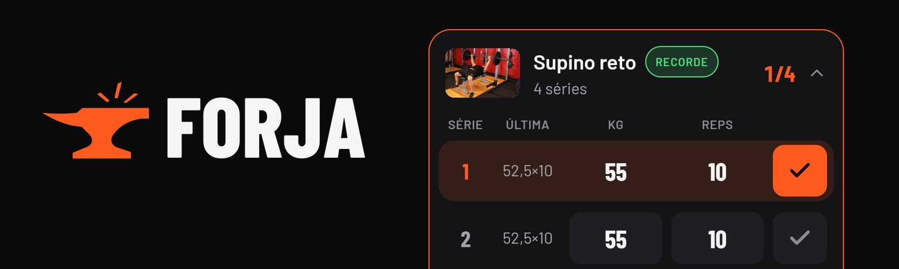
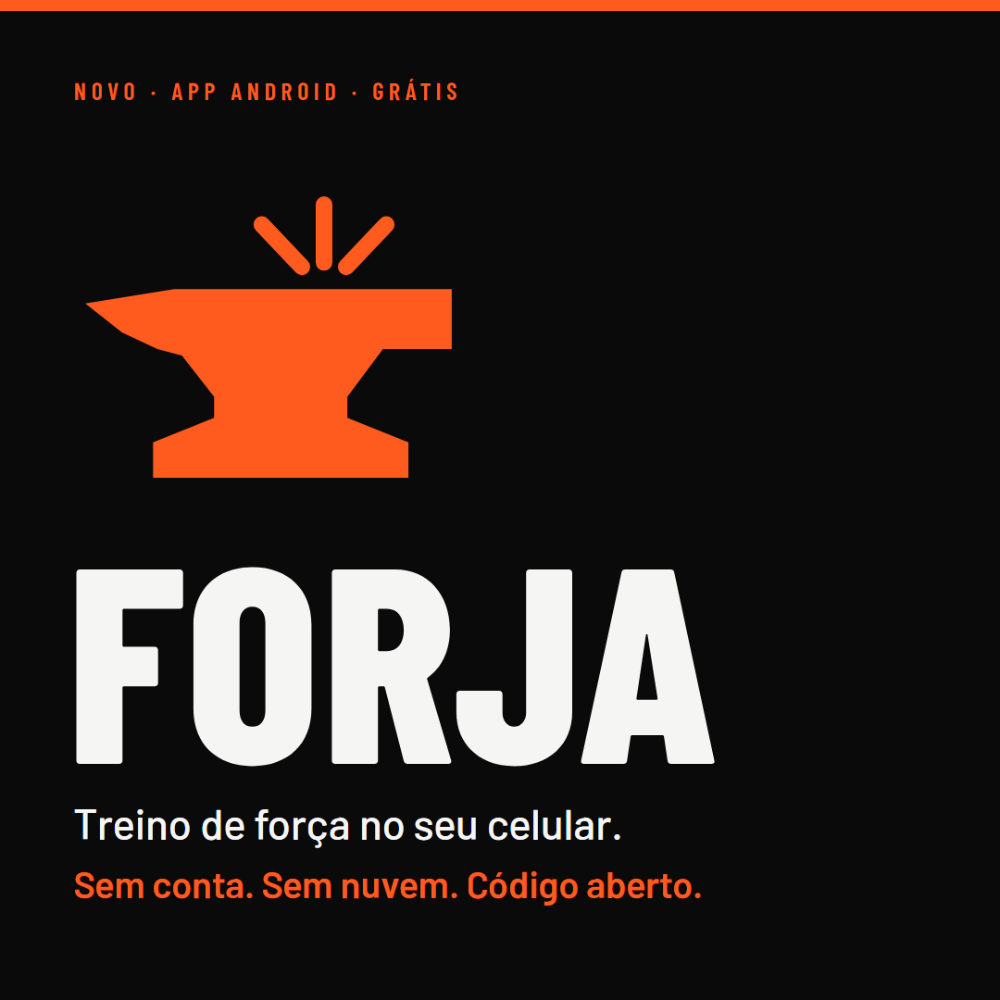
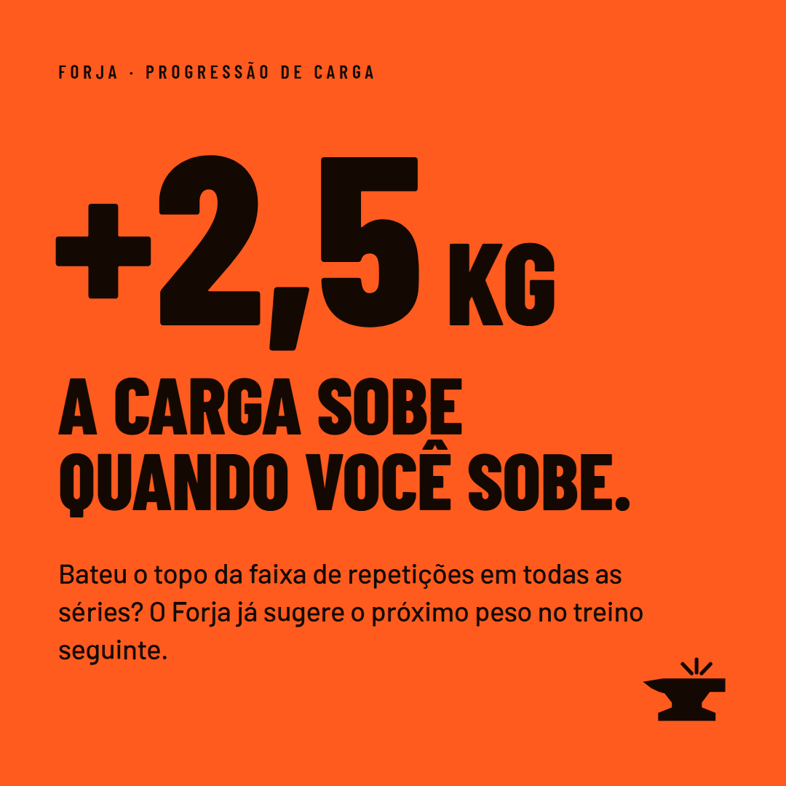
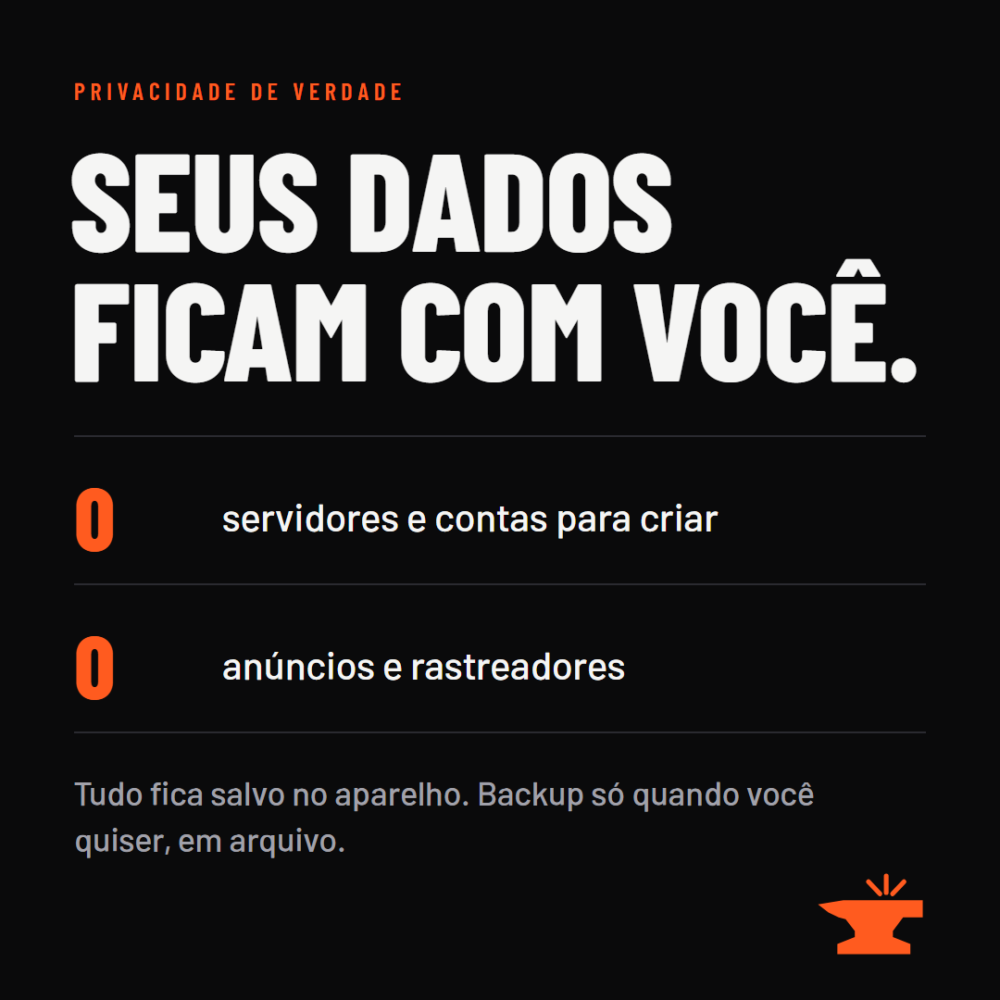
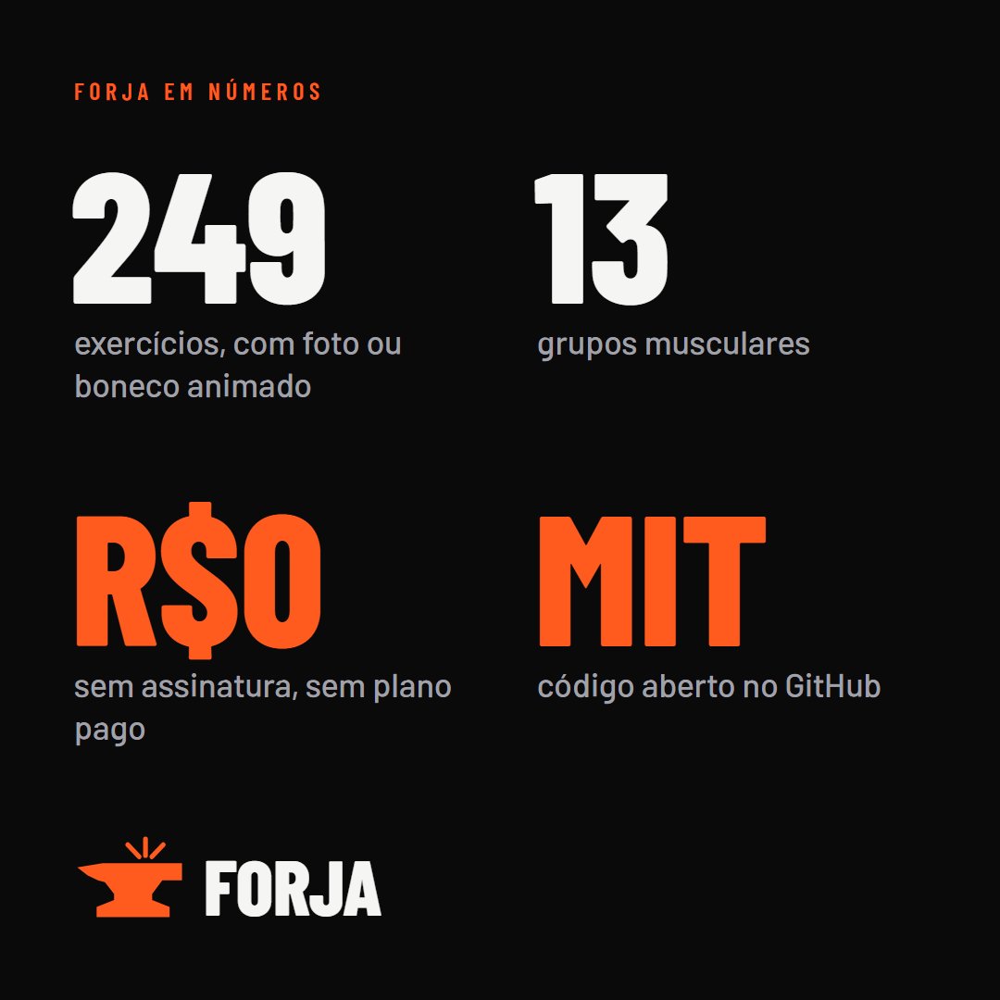
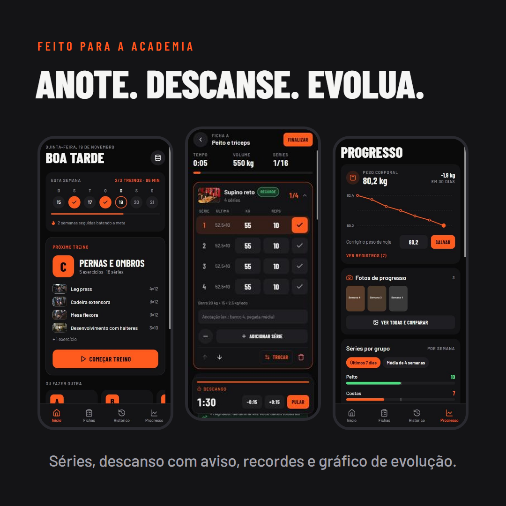

# Marca do Forja

Guia curto para manter o Forja com a mesma cara em qualquer lugar: ícone, README, posts.

## A ideia

**Forja** é onde o metal vira ferramenta à força de repetição: é o treino. A marca é uma **bigorna com
três faíscas** saindo do ponto da batida. Tom direto, sem exagero de academia: frases curtas, números
de verdade, nada de "monstro" ou "shape".

- **Diz:** Treino de força no seu celular. Sem conta, sem nuvem, código aberto.
- **Promete só o que o app faz:** progressão de carga, recordes, descanso com aviso, dados no aparelho.

## Logo

Todos os arquivos estão em [`logo/`](logo/), em vetor (SVG).

| Arquivo | Uso |
|---|---|
| [forja-assinatura-repositorio.svg](logo/forja-assinatura-repositorio.svg) | Assinatura da capa do README, com a ponta da bigorna alongada e três faíscas menores. Para uso sobre fundo carvão. |
| `forja-assinatura-escuro.svg` | Assinatura completa (marca + nome) em fundo escuro |
| `forja-assinatura-claro.svg` | Assinatura para fundo claro (nome em preto) |
| `forja-assinatura-transparente-claro.svg` | Assinatura com nome claro e fundo transparente |
| `forja-marca-laranja.svg` | Só a bigorna, laranja |
| `forja-marca-branco.svg` / `forja-marca-preto.svg` | Uma cor só (sobre fotos, sobre o laranja, impressão) |
| `forja-icone-app.svg` | Ícone do app (quadrado, fundo escuro) |
| `forja-icone-adobe.svg` | O mesmo ícone vetorizado pelo Adobe Illustrator (traçado automático do PNG) |

Os SVGs "exatos" saem da mesma geometria dos ícones do app (`python scripts/gerar-logo-svg.py`), e o
nome "FORJA" já vem em contorno, então abrem certo em qualquer programa sem a fonte instalada.

**Regras:** deixe em volta do logo um espaço livre de pelo menos a altura das faíscas. Não gire, não
estique, não troque a cor da bigorna por outra fora da paleta, não ponha sombra nem contorno.
Sobre o laranja, a marca vai em quase preto (`#140802`).

## Cores

| Nome | Hex | Uso |
|---|---|---|
| Brasa (destaque) | `#FF5B1F` | Marca, números de destaque, botões. Usar pouco: é o que chama o olho |
| Carvão (fundo) | `#0A0A0B` | Fundo principal |
| Superfície | `#141416` | Cartões, fundos secundários |
| Linha | `#2A2A30` | Divisórias, bordas |
| Texto | `#F5F5F4` | Títulos e texto sobre fundo escuro |
| Texto secundário | `#A1A1AA` | Legendas, explicações |
| Sobre a brasa | `#140802` | Texto e marca sobre fundo laranja |
| Alta (sucesso) | `#4ADE80` | Só na interface: carga subiu, recorde |

São as mesmas cores do app (`src/theme.ts`).

## Tipografia

- **Barlow Condensed ExtraBold (800)**, em maiúsculas: títulos, números grandes, o nome FORJA.
- **Barlow Condensed SemiBold (600)**, maiúsculas com espaçamento largo: etiquetas pequenas ("NOVO · APP ANDROID").
- **Barlow Medium (500) / SemiBold (600)**: texto corrido.

As duas são livres (SIL OFL), estão no Google Fonts e no Adobe Fonts, e já são as fontes do app.

## Posts de anúncio

Cinco posts quadrados (1080 × 1080) em [`posts/`](posts/), também abertos como projeto editável no
**Adobe Express** ("Forja — posts de anúncio").

| | Post | Mensagem |
|---|---|---|
|  | Lançamento | Bigorna, nome e a promessa: sem conta, sem nuvem, código aberto |
|  | Progressão | "+2,5 kg — a carga sobe quando você sobe" |
|  | Privacidade | "Seus dados ficam com você" |
|  | Números | 249 exercícios, 13 grupos, R$ 0, MIT |
|  | Telas | As três telas do app: início, treino, progresso |

Para mudar um texto: edite `posts/posts.template.html` e rode `python branding/posts/montar.py`
(gera `forja-posts.html`, com logo e telas embutidos), ou edite direto no Adobe Express.
